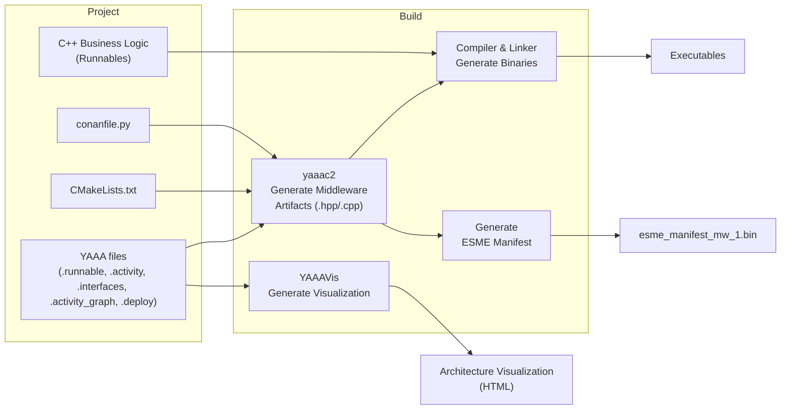

## Build

In this section, we will build the project using Conan and 
CMake. Follow these steps to ensure a successful build.

The figure below shows a high-level description of the build process:



* A project consists of the project configuration file (`conanfile.py`), `CMakeLists.txt` files, YAAA architecture description files and the business logic implemented in C++ (runnables).
* The YAAA compiler (`yaaac2`) reads the YAAA architecture description and generates middleware artefacts as defined in the project configuration.
* The generated middleware artefacts are compiled and linked together with the source code of the business logic and libraries of the SDK. This creates one or multiple executables.
* An ESME manifest file is generated to configure and manage the application processes at runtime.
* To visualize the architecture, YAAAVis generates an interactive HTML file based on the YAAA architecture description files.

### Step-by-step build process

>Execute each of the commands in the root directory of the example.

1. Clean Previous Builds

    Before starting a new build, it's recommened to clean any previous build artifacts. This is especially important if the previous build was done for a different target.

    ```
    rm -rf install build 
    ```

2. Install dependencies

    Use Conan to install the necessary dependencies for your project.

    >If you are working inside the EAP (Early Access Program) devcontainer instead of a standalone SDK installation, the required packages are provided under a different Conan channel. In that case, run the following command in your terminal first, before the `conan install` command below:
    >```
    >export AOS_CHANNEL=eap
    >```

    ```
    conan install . -if=install 
    ```

3. Build the project

    Build the project using CMake, specifying the install directory.

    ```
    conan build . -if=install -bf=build 
    ```

### Expected output

After running the above commands, you should see output indicating that the dependencies were installed and the project was built successfully.

Output after conan install:

```
...
conanfile.py (hello_world/0.0.1): Generated conaninfo.txt
conanfile.py (hello_world/0.0.1): Generated graphinfo
conanfile.py (hello_world/0.0.1) imports(): Copied 25 '.so' files
conanfile.py (hello_world/0.0.1) imports(): Copied 3 files: esme, recompute_recall_player, mta_raw_output_gateway
```

>The exact number of copied files and generated artifacts can vary slightly depending on the SDK version and distribution you are using (standalone SDK vs. EAP). This is expected — what matters is that the command completes without errors and ends with an `imports()` line.

Output after conan build (default `MIDDLEWARE_TARGET=noviroc`):

```
...
[WARNING ] ../../deployment/Deployment.deploy.yaml:27:17: MTA gateways will not be started by esme in this version of AOS. When manually starting the gateway for the configuration 'raw_gateway', please ensure that the same cycle period (200 ms) is used.
...
[ 92%] Built target Deployment_mw_1_dmc_mta_adapter
[ 95%] Built target Producer_activity
[100%] Built target Consumer_activity
[100%] Built target Deployment_deploy
[100%] Built target all_deploys
```

>The WARNING about the `raw_gateway` cycle period is expected and not an error — it is a reminder for the **[Record](06-record.md)** section, where the MTA RAW gateway is started manually and must use a matching cycle period.


Any errors encountered during this process will be displayed in the terminal. Make sure to resolve them before proceeding.

### Tips

- Ensure that your `conanfile.py` and `CMakeLists.txt` are correctly configured before starting the build process.
- Regularly clean your build environment to avoid conflicts.

Now that we have successfully built the project, let's move on to visualizing the model.

Previous section: [Develop](02-develop.md) | Next section: [Visualize](04-visualize.md)
