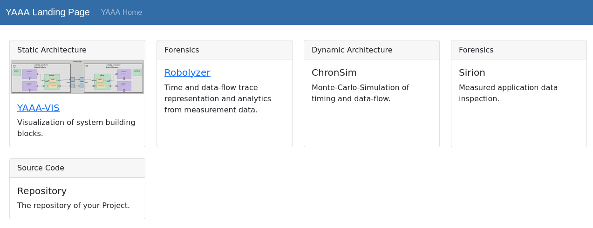
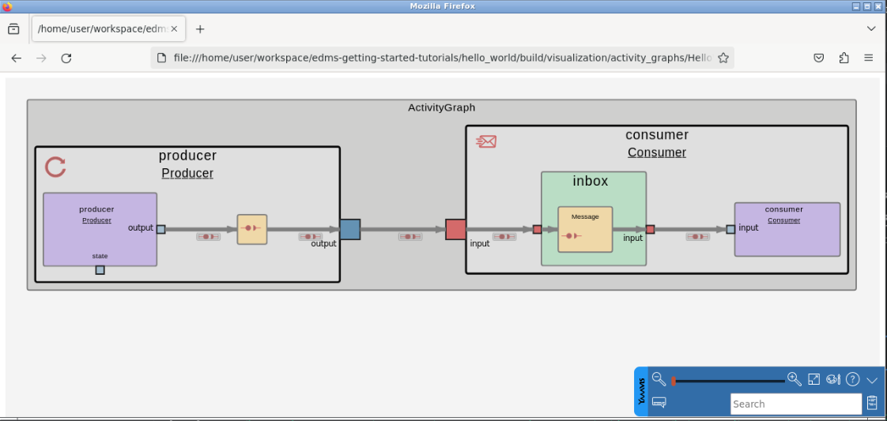

## Visualization

In this section, we will visualize the architecture model generated by the YAAA compiler (YAAAC) after a successful build.

### Viewing the architecture model in your browser

1. Locate the visualization file

    After the build, the YAAA compiler generates a visualization of your model. This file is located in the `./build/visualization` directory.

2. Open the visualization file

    Use your preferred web browser to open the `index.htm` file.

    ``` sh
    firefox build/visualization/index.htm 
    ```



Click on **YAAA-VIS** and then on **HelloWorld.activity_graph** to get to see your activity graph.



### Tips

- Ensure that the build was successful before attempting to visualize the model.
- Use the browser visualization for a complete overview.

Now that we have visualized the model, let's proceed to running the application.

Previous section: [Build](03-build.md) | Next section: [Run](05-run.md)
