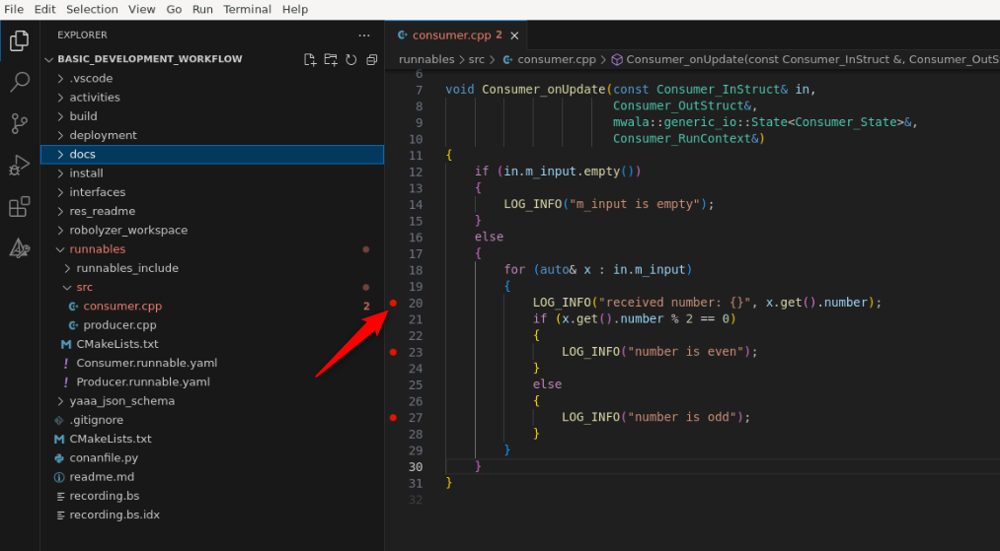
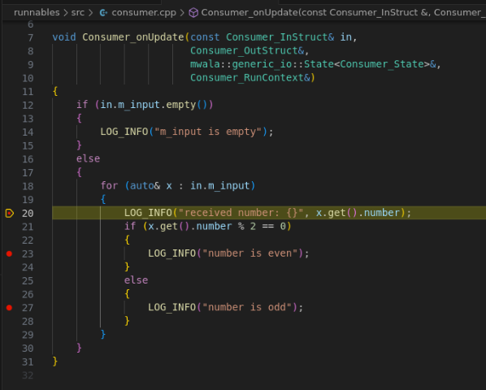

## Debug

This section extends **[Recompute](07-recompute.md)**: instead of just replaying recorded data, VS Code attaches GDB to the recall player while it replays, so breakpoints in your C++ business logic are hit as if the system were running live. The setup is the same as in Recompute, with two additions: setting a breakpoint beforehand, and attaching VS Code before playback starts.

### Prerequisites

- The application must be built as described in the **[Build](03-build.md)** section.
- A Bytesoup file must be recorded as described in the **[Record](06-record.md)** section.
- `basic_development_workflow` must be added to your VS Code workspace as its own folder, not via a parent folder — see **[Using this example alongside an existing workspace](vscode.md#using-this-example-alongside-an-existing-workspace)**. Otherwise VS Code won't find `launch.json`, and the debug configuration used in step 5 won't be available.

### Steps to recompute and debug

1. Build for the recall target

    Skip this step if you already did it as part of **[Recompute](07-recompute.md)**.

    ```bash
    conan install . -if=install -o MIDDLEWARE_TARGET=recall
    conan build . -if=install -bf=build
    ```

2. Source the run environment (in every new terminal used below)

    ```bash
    source ./install/activate_run.sh
    ```

3. Set a breakpoint in your business logic

    Open your business logic code in Visual Studio Code and set a breakpoint at the desired location.

    

4. Start the recall player

    Keep this terminal running the player; you'll use another one for playback commands in step 6.

    ```bash
    export LD_LIBRARY_PATH=$LD_LIBRARY_PATH:$(pwd)/build/lib

    dol_player_rest_server \
        --recall-local \
        --recorder-filepath "recall_out.bs" \
        --system-library-path libDeployment_deploy_mw_1_recall_system.so &
    ```

5. Attach VS Code to the running process

    Open the **Run and Debug** view (`Ctrl+Shift+D`), select **"Attach to Recall Player"** from the dropdown, and press **F5**. When prompted, pick the `dol_player_rest_server` process from the list.

6. Configure, open and play the recording

    In a terminal with the environment sourced:

    ```bash
    dol player configuration --strategy recall_fixed
    dol player open recording.bs
    dol player play --attached
    ```

    When execution reaches your breakpoint, VS Code pauses so you can inspect variables and step through the code.

    

7. Stop and quit

    Resume execution in VS Code if still stopped at a breakpoint, then:

    ```bash
    dol player stop
    dol player quit
    ```

    This also ends the debug session in VS Code, since it stops the process VS Code was attached to.

### Tips

- `dol player open` must run before `dol player play`, otherwise playback fails with `open data source first`.
- If **"Attach to Recall Player"** doesn't show up in the Run and Debug dropdown in step 5, the folder likely wasn't added to the workspace correctly — see **[Using this example alongside an existing workspace](vscode.md#using-this-example-alongside-an-existing-workspace)**.
- **Attaching in step 5 asks "Superuser access is required to attach to a process ... [y/N]"?**
  Linux blocks debuggers from attaching to processes they didn't start themselves, so VS Code asks to attach as superuser. Type `y` in the terminal that shows the question and debugging works as usual.

    To avoid the question, run this once on your machine until the next reboot (if you use a Dev Container, run it on the host, not inside the container):

    ```bash
    echo 0 | sudo tee /proc/sys/kernel/yama/ptrace_scope
    ```

Congratulations! You have successfully recomputed and debugged your business logic using the recall player and GDB in VS Code.

Previous section: [Recompute](07-recompute.md) | [Back to beginning](../readme.md)
