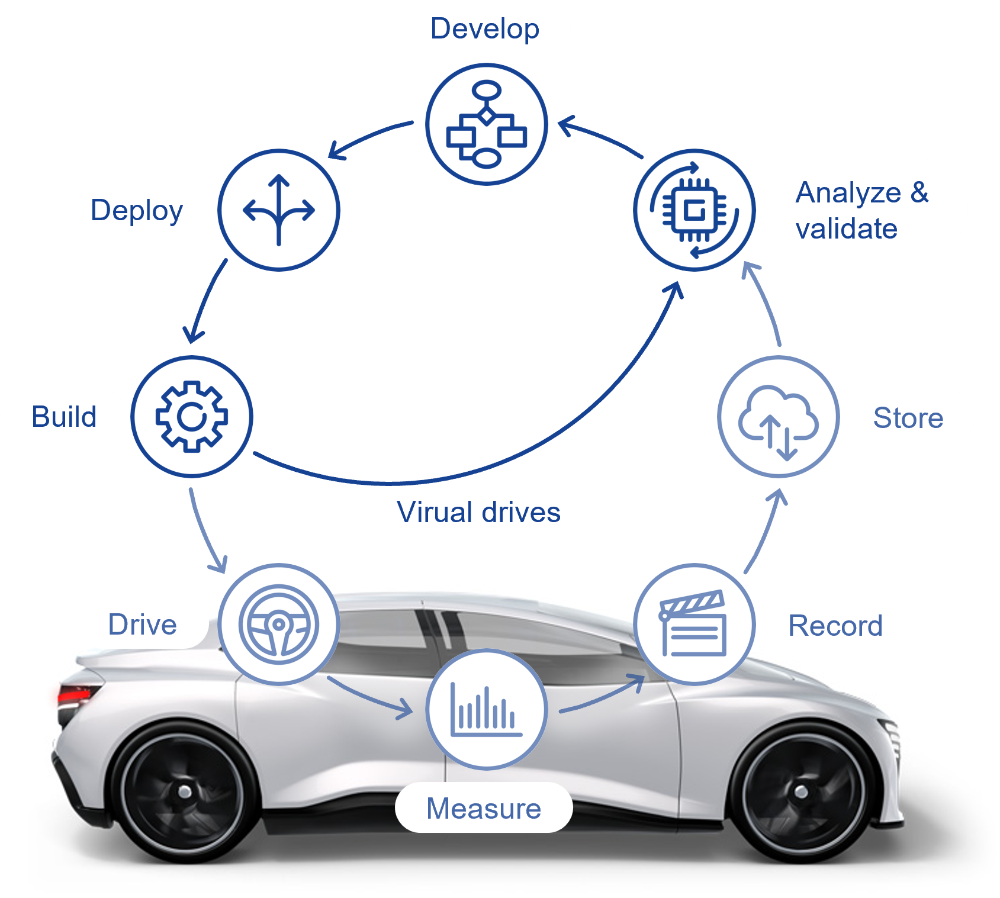
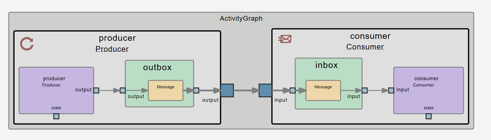

# Basic Development Workflow

This tutorial guides you as an individual developer through the entire development cycle for an application.

## What you will do and achieve

The tutorial is split into multiple following sections that build on each other. Following the tutorial, you will achieve the following:

- **[Develop](docs/02-develop.md)**: Understand the project structure in YAAA (Yaml As an Architecture) and business logic of the application (C++).
- **[Build](docs/03-build.md)**: Compile the application using Conan and CMake.
- **[Visualize](docs/04-visualize.md)**: View the generated architecture model visualization in your browser.
- **[Run](docs/05-run.md)**: Execute the application using either a start script or ESME (Execution and State Manager).
- **[Record](docs/06-record.md)**: Capture data from the running application and store it in a file.
- **[Recompute](docs/07-recompute.md)**: Replay the recorded data with the <a href="https://edms.etas.com/explanations/recall.html" target="_blank">Recall player</a>.
- **[Debug](docs/08-debug.md)**: Step through the business logic (C++ code) in Visual Studio Code while it replays.

By the end of this tutorial, you will have developed, built, visualized, run, recorded, recomputed and debugged your first application.
Through this, you will have achieved a full roundtrip through the [AD Cycle](https://edms.etas.com/the-ad-cycle-how-it-works.html). 
As part of this, you will also have gotten to know the main tools of the SDK.

## The application

The tutorial is using a simple "Hello World" example, consisting of a Producer and Consumer process.

## Important Notes

- This tutorial description can be used with any other project, but however this project is preconfigured for the specific use cases covered here.
- It complements, but does not replace, the more detailed tutorials available in the **tutorial** folder.
- For a deeper understanding of concepts, refer to the training materials.

Let's get started!

Next section: [Develop](docs/02-develop.md)